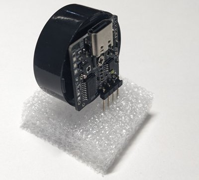

# オリジナル電子工作キット

自作の電子工作キット・モジュールを紹介しています。各作品の名前をクリックすると、写真、動画、マニュアル、詳しい解説のページに移動します。

## 作品一覧

| 写真 | 作品 | 概要 | 状況 |
|---|---|---|---|
|  | [オーディオアンプ内蔵メロディモジュール MUSICBOX-MIDI FS-01](fs-01/README.md) | USB フラッシュメモリに書き込んだ標準MIDIファイルを、小型スピーカーで演奏するモジュール | 準備中 |

## 連絡先

ご質問や不具合の報告は、このリポジトリの [Issues](../../issues) からお願いします。
