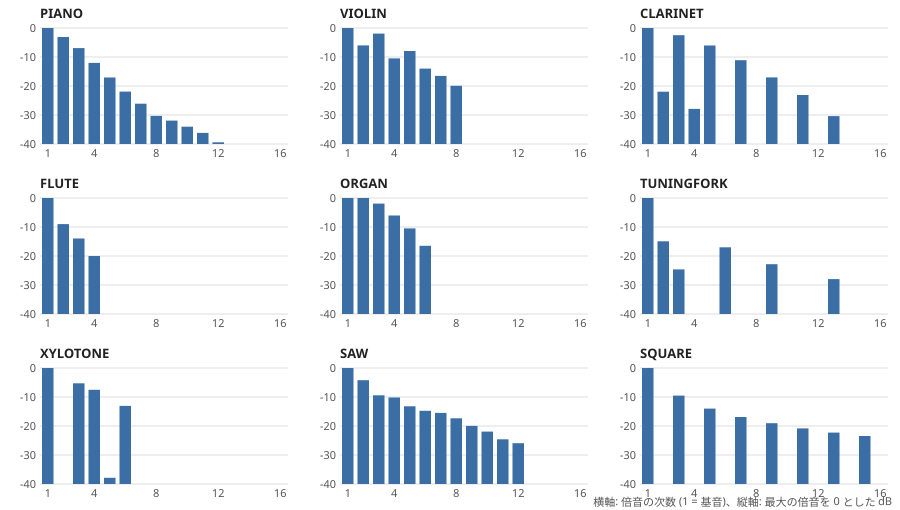

# オーディオアンプ内蔵 9曲入りメロディモジュール [MUSICBOX-MIDI FS-01]

<!-- [モジュール一覧へ](../README.md) -->


| ダイナミックスピーカーを駆動して、楽器9音色とドラム5音色で音楽を演奏するメロディモジュールです。PC に接続すると USB フラッシュメモリとして認識され、書き込んだ標準 MIDI ファイルを順に演奏できます。また設定ファイルを書き込むと、曲・MIDIチャンネルごとに音量、音色、演奏速度などをアレンジできます。Web アプリ上で、MIDI ファイルがどのように演奏されるかをシミュレーションして試聴できます。市販の円形の小型スピーカーの背面に直接取り付けられます。 |
|:---|

<!--
- [演奏] [進む] [戻る] スイッチを追加して演奏をコントロールできます
- MIDI ファイルが本機でどのように演奏されるか、ブラウザ上のエミュレータで確認できます
-->

## ■ 演奏動画
[](https://www.youtube.com/watch?v=f5hhHijweYc)

初期状態でフラッシュメモリに書き込まれているクラシックのアレンジ曲 9 曲です

### ● その他の演奏例
- [&#x23e9; JPOP](https://www.youtube.com/watch?v=M8qboCkSDZQ)
- [&#x23e9; Ys MIDI Collection (Original)](https://www.youtube.com/watch?v=lWfWd9daLQ0)
- [&#x23e9; Ys MIDI Collection (SC88)](https://www.youtube.com/watch?v=2OQQydvg6u0)

## ■ 仕様

| 項目 | 値 |
|---|---|
| 電源電圧 | 2.4～3.6 V、または 5 V (USB 給電可) |
| MIDI ファイル保存用フラッシュメモリ | 約 150 kB |
| サイズ・質量 | 22 × 22 × 3.5 mm、1.7 g |

## ■ 使い方
SP+ と SP- 端子にダイナミックスピーカーを接続し、VDD 端子から 2.4～3.6V を給電すると、フラッシュメモリに書き込まれている MIDI ファイルがファイル名の順に演奏されます。

-  MIDI ファイルは USB フラッシュメモリのルートディレクトリに置きます。演奏できるファイルは Format0 または Format1 の 標準 MIDI 形式です。拡張子は .MID (未圧縮) または .GZ (Web アプリで圧縮済) です。
- MIDI ファイルの音量が大きい場合は、音割れを防ぐために音量を設定してください。下記の Web アプリで書き込んだ場合は自動で最適な音量が設定されます。手動で書き込んだ場合は、設定ファイル (MIDI.TXT) で音量を指定してください。

> [!WARNING]
>  ピエゾスピーカーではほとんど音が聞こえません。4～32 Ω のダイナミックスピーカーを接続してください。

## ■ ダウンロード
- 簡易マニュアル (PDF)
  - [FS-01_manual.pdf](docs/FS-01_manual.pdf)
- 初期 MIDI ファイル(9曲)と設定ファイル
  - [MIDIV1.ZIP](docs/MIDIV1.ZIP)

## ■ 名称と機能


### ● 基本機能とピン
&#x24B6; 〜 &#x24B9; の4ピンで動作を制御できるようになっています。

| 記号 | 回路図上のラベル | 機能 |
|---|---|---|
| &#x24B6; | TRIGGER (PA3) | トリガ |     <!-- A -->
| &#x24B7; | GND | GND |                  <!-- B -->
| &#x24B8; | FILESEL (PA7) | モード選択 | <!-- C -->
| &#x24B9; | 3_3V | VDD (2.4～3.6V) |     <!-- D -->
| &#x24BA; | SP1 | スピーカー出力 (SP+) |     <!-- E -->
| &#x24BB; | SP1 | スピーカー出力 (SP-) |     <!-- F -->
| &#x24BC; | R1 | 音量調節つまみ |        <!-- G -->
| &#x24BD; | R14, LED2 | フォトトランジスタ接続用端子 | <!-- H -->
| &#x24BE; | LED1 | USB アクセス LED |    <!-- I -->

> [!NOTE]
> 起動時のトリガ端子(&#x24B6;) とモードセレクト端子(&#x24B8;) の状態によって、下記の「動作モード」の動作を行います。&#x24B6; と &#x24B8; に何も接続しなければ連続演奏モードになり、常に演奏を続けます。

### ● その他の機能とピン
| 記号 | 回路図上のラベル | 機能 |
|---|---|---|
| ① | PWM (PA0)| PWM 音声出力 |
| ② | RESET | NRST |
| ③ | BOOT0 | BOOT0 |
| ④ | RECOVER (PA6) | リカバリモード用入力 |
| ⑤ | GND | GND |
| ⑥ | 3_3V | VDD (2.4～3.6V) |
| ⑦ | 5V | 電源 (5V) |
| ⑧ | 5V | 電源 (5V) |
| ⑨ | GND | GND |
| ⑩ | SWDIO | SWDIO |
| ⑪ | SWDCL | SWDCL |
| ⑫ | TX (PA2)| TX |

> [!NOTE]
> VDD の代わりに USB または ⑦,⑧ の電源 (5V) 端子から給電することもできます。その場合は内蔵のレギュレータで降圧され、VDD 端子に 3.3V が出力されます。

## ■ 回路図
[](images/schematic1.pdf)

## ■ 動作モード
起動時のトリガ端子(&#x24B6;) とモードセレクト端子(&#x24B8;) の状態によって「連続演奏モード」「オルゴールモード」「チャイムモード」のいずれかの動作を行います。

| 起動時のモードセレクト端子(&#x24B8;) | 起動時のトリガ端子(&#x24B6;) | 動作モード |
|---|---|---|
| オープン | オープン | (1) 連続演奏モード |
| オープン | H または L | (2) オルゴールモード |
| H または L | - | (3) チャイムモード |

### (1) 連続演奏モード


起動時にモードセレクト端子(&#x24B8;) とトリガ端子(&#x24B6;) が両方オープンの場合は、連続演奏モードになります。このモードでは常に演奏を続けます。

※ 演奏中は、モードセレクト端子(&#x24B8;)を使って曲の選択ができます。モードセレクト端子(&#x24B8;)に H を入力すると次の曲に進み、L を入力すると前の曲に戻ります。最初の曲で前の曲に戻る操作をしても無視されます。

> [!WARNING]
> モードセレクト端子(&#x24B8;)を H または L にしたまま電源を入れるとチャイムモードで起動します。スイッチやジャンパピンで曲を選択する場合は、オープンの状態で電源を入れてください。

### (2) オルゴールモード


起動時に、モードセレクト端子(&#x24B8;)がオープンで、かつトリガ端子(&#x24B6;)が H または L の場合はオルゴールモードになります。このモードでは、トリガ端子(&#x24B6;)が L の間は演奏し、H になると停止します。

※ 演奏中は、モードセレクト端子(&#x24B8;)を使って曲の選択ができます。モードセレクト端子(&#x24B8;)に H を入力すると次の曲に進み、L を入力すると前の曲に戻ります。最初の曲で前の曲に戻る操作をしても無視されます。ただし演奏停止中はスリープモードのため、モード端子(&#x24B8;)への入力は無効です。

### (3) チャイムモード


モードセレクト端子(&#x24B8;) が H または L の状態で起動すると、トリガ端子(&#x24B6;)が L になるたびに、1 曲を最後まで演奏し停止します。再度トリガ端子が L になると、次の曲が演奏されます。演奏中にトリガ端子が L になっても無視されます。トリガ端子(&#x24B6;)に何も接続しないと演奏しません。

## ■ 設定ファイルの例

USB フラッシュメモリのルートディレクトリに `MIDI.TXT` を置くと、曲・MIDIチャンネルごとに音量、音色、演奏速度などをアレンジできます。指定に間違いがある行は単に無視されます。詳細な文法は下記の「MIDI.TXT の文法」の節を参照してください。

```
# MIDI.TXT Example
SONG(1).FILE=MYSONG1.MID   # 1曲目のファイル名
SONG(1).SPEED=120          # 速度120%
SONG(1).CH(1).VOL=3        # CH1 の音量を +3dB
SONG(1).CH(2).INST=FLUTE   # CH2 の音色をフルートに
SONG(2).FILE=MYSONG2.MID   # 2曲目のファイル名
SONG(2).ALL.VOL=-6         # 全 CH の音量を -6dB
SONG(2).START=20           # 20秒目から開始
SONG(2).LEN=60             # 開始から60秒間演奏
```

> [!WARNING]
> MIDI.TXT 内で指定できるファイル名は 8+3 形式のみです。ロングファイルネームは指定できません。MIDI.TXT がある場合は、ファイル内で指定した MIDI ファイルのみが演奏されて、それ以外は演奏されません。

## ■ MIDI ファイル圧縮書き込み用 Web アプリ


- [Web アプリを開く](https://hoshimilkali.github.io/kits/tools/ppgsynth_gzweb.html)
### ● 機能
- Edge/Chrome 用の Web アプリです。
- MIDI ファイルがどのように再生されるかを試聴できます。ブラウザ上で音色や演奏時間、演奏速度をアレンジできます。
- 試聴・アレンジ後に MIDI ファイルを圧縮して、本モジュールに直接書き込めます。設定ファイル MIDI.TXT も同時に書き込めます。モジュールを USB 接続して「音楽ファイルを書き込み」「MIDI.TXT を書き込み」ボタンを押し、書き込み先のドライブを指定してください。
- 単一の HTML ファイルです。ブラウザ内で動作し、ファイルは外部に送信されません。


## ■ スピーカーの選択
- 下記のダイナミックスピーカーの背面に取り付けられるサイズになっています。

| スピーカー | 取付時表面 | 取付時裏面 | URL |
|---|---|---|---|
| [UGSM30A-8-01 (秋月)](https://akizukidenshi.com/catalog/g/g109270/) |  |  | 0.15W, 直径29mm, 厚さ12.7mm, ピン間隔15mm |
| [UGSM23A (秋月)](https://akizukidenshi.com/catalog/g/g109797/ )|  |  | 0.08W, 直径22.5mm, 厚さ8.5mm, ピン間隔10mm |

## ■ フォトトランジスタによる演奏の ON/OFF


- 画像のように、基板上にフォトトランジスタ (LED2, NJL7502L) を追加すると、明るいところで演奏を開始するオルゴールとして動作します。
- スピーカーに [UGSM23A (秋月)](https://akizukidenshi.com/catalog/g/g109797/) を使用し、基板上の JPT のシルクのランドをショートしてください。 動作モードはオルゴールモードになります。モードセレクト端子(&#x24B8;)による曲の選択も可能です。

## ■ MIDI.TXT の文法

`MIDI.TXT` は、USB フラッシュメモリのルートディレクトリに置くテキストファイルです。演奏する曲の順番や、曲ごと・MIDI チャンネルごとの音量、音色、速度などを指定します。無くても動作します (後述の「曲の順番と MIDI.TXT が無いとき」を参照)。

### ● 書き方の基本

1 行に 1 つの設定を `キーワード=値` の形で書きます。

```
SONG(1).CH(2).VOL=-3
```

- 大文字と小文字は区別しません。`song(1).ch(2).vol=-3` でも同じです。
- `=` の前後と行頭・行末の空白は無視します。
- `#` から行末まではコメントです。ただし `#` が行頭にあるか、`#` の直前が空白のときだけです。行末にコメントを書くときは `#` の前に空白を入れてください (`A#1.MID` のように `#` を含むファイル名を書けるようにするためです)。
- 曲番号とチャンネル番号は `SONG(1)`、`CH(2)` のようにカッコで囲みます。カッコの中には空白を入れられますが、`SONG (1)` のように名前とカッコの間には入れられません。
- 1 行は 64 バイトまでです。超えた部分は読み捨てます。
- 改行は CRLF (Windows) と LF のどちらでもかまいません。先頭の BOM も読み飛ばします。
- 書き方に誤りがある行、知らないキーワードの行、範囲外の値の行は、何も知らせずに無視します。設定が効かないときは、まずその行の綴りを確かめてください。[Web アプリ](https://hoshimilkali.github.io/kits/tools/ppgsynth_gzweb.html) の MIDI.TXT の入力欄では、無視される行が赤で表示されます。

### ● 3 つの階層

設定には「装置全体」「曲ごと」「チャンネルごと」の 3 つの階層があり、キーワードの段数 (`.` で区切った数) で区別します。

| 階層 | キーワードの形 | 例 | 意味 |
|---|---|---|---|
| 装置全体 | `キーワード` (1 段) | `REPEAT=OFF` | 全曲を演奏したら停止する |
| 曲ごと | `曲.キーワード` (2 段) | `SONG(1).SPEED=90` | 1 曲目を 90% の速さで演奏する |
| チャンネルごと | `曲.チャンネル.キーワード` (3 段) | `SONG(1).CH(2).VOL=-3` | 1 曲目の CH2 の音量を -3dB にする |

キーワードごとに書ける階層が決まっています。たとえば音量 `VOL` はチャンネルごとのキーワードなので、必ず 3 段で書きます。

```
SONG(1).CH(2).VOL=-3     # 正しい
SONG(1).VOL=-3           # 誤り (チャンネルの段が無い)。この行は無視される
```

チャンネルの段を省いた書き方を「全チャンネル」とみなさないのは、`CH(2)` の書き忘れに気付けるようにするためです。全チャンネルに指定したいときは、次に説明する `ALL` を書きます。

- 曲の段に書けるのは `SONG(0)`〜`SONG(15)` と `ALL` です。この文書の例では `SONG(1)` から始めていますが、`SONG(0)` も使えます。
- チャンネルの段に書けるのは `CH(1)`〜`CH(16)` と `ALL` です。ドラムは `CH(10)` です。

### ● ALL でまとめて指定する

曲の段やチャンネルの段に `ALL` と書くと、「すべての曲」「すべてのチャンネル」への指定になります。音量 `VOL` を例にすると、次の 4 通りの書き方ができます。

| 書き方 | 対象になる曲 | 対象になるチャンネル |
|---|---|---|
| `SONG(1).CH(2).VOL=-3` | 1 曲目だけ | CH2 だけ |
| `SONG(1).ALL.VOL=-3` | 1 曲目だけ | すべてのチャンネル |
| `ALL.CH(2).VOL=-3` | すべての曲 | CH2 だけ |
| `ALL.ALL.VOL=-3` | すべての曲 | すべてのチャンネル |

曲ごとのキーワードでは、曲の段にだけ `ALL` を書けます。

| 書き方 | 意味 |
|---|---|
| `SONG(2).SPEED=110` | 2 曲目だけ 110% の速さ |
| `ALL.SPEED=110` | すべての曲を 110% の速さ |

`ALL` の代わりに `DEFAULT` と書いても同じ意味です。

### ● = と += と優先順位

#### ALL と SONG(n) の両方に書いた場合

同じキーワードを `ALL` と `SONG(n)` の両方に `=` で書いた場合は、`SONG(n)` の方が優先されます。行の順番は関係ありません。

```
ALL.SPEED=110        # 全曲 110%
SONG(3).SPEED=90     # ただし 3 曲目だけは 90%
```

#### += で足す

`=` の代わりに `+=` と書くと、それまでの値に足す指定になります。`ALL` で全体の値を決めておき、曲ごとに少しだけ変えたいときに便利です。

```
ALL.ALL.VOL=-2         # 全曲 -2dB
SONG(2).ALL.VOL+=-3    # 2 曲目だけ、さらに -3dB (合計 -5dB)
```

値は次の順に決まります。行の順番は関係ありません。

1. 既定値
2. `ALL` の `=` (複数あればファイルの中で最後の行)
3. `ALL` の `+=` をすべて足す
4. `SONG(n)` の `=` があれば、ここまでの値を置き換える
5. `SONG(n)` の `+=` をすべて足す
6. 値の範囲に収める

`+=` を使えるのは数値のキーワード (`GAP`、`SPEED`、`START`、`LEN`、`VOL`、`TRANS`、`PRI`、`DETUNE`、`ECHO`) だけです。

#### チャンネルの ALL と CH(m) は足し算

チャンネルの段の `ALL` と `CH(m)` は、どちらかが優先されるのではなく、発音のときに足し算されます。

```
SONG(1).ALL.VOL=2
SONG(1).CH(1).VOL=-1   # CH1 は 2 + (-1) = +1dB、他のチャンネルは +2dB
```

### ● 装置全体の設定

1 段で書きます。曲やチャンネルの段を付けた行は無視します。

| キーワード | 値 | 既定 | 意味 | 例 |
|---|---|---|---|---|
| `REPEAT` | `ON` / `OFF` | `ON` | 最後の曲の後、先頭に戻って演奏を続けるか。`OFF` なら全曲を 1 回演奏したら停止する | `REPEAT=OFF` |
| `GAP` | 0〜10000 | 500 | 曲と曲の間の待ち時間 (ミリ秒) | `GAP=2000` (2 秒) |
| `SLEEP` | `ON` / `OFF` | `ON` | 停止中に低消費電力の Stop モードに入るか | `SLEEP=OFF` |

### ● 曲ごとの設定

`SONG(n).キーワード` または `ALL.キーワード` の 2 段で書きます。

| キーワード | 値 | 既定 | 意味 | 例 |
|---|---|---|---|---|
| `FILE` | ファイル名 | なし | 演奏する MIDI ファイル。`FILE` の無い `SONG(n)` は曲として数えない | `SONG(1).FILE=CANON.MID` |
| `SPEED` | 50〜200 | 100 | 演奏速度 (%)。曲中のテンポの変化も同じ割合で変わる | `SONG(1).SPEED=80` (80% の速さ) |
| `START` | 0〜65535 | 0 | 演奏を始める位置 (秒) | `SONG(1).START=30` (30 秒目から) |
| `LEN` | 0〜65535 | 0 | 演奏する長さ (秒)。0 なら最後まで | `SONG(1).LEN=60` (60 秒間) |
| `FADEOUT` | `ON` / `OFF` | `ON` | `LEN` で打ち切るとき、最後の 2 秒でフェードアウトするか | `SONG(1).FADEOUT=OFF` |
| `MAP(GM番号)` | 音色名 / ドラム名 / `MUTE` | 後述の表 | GM の音色番号をどの内蔵音色で鳴らすか | `ALL.MAP(25)=PIANO` (ギターをピアノで) |

#### FILE

- ファイル名は 8+3 形式 (SFN = Short File Name) で書きます。本機はロングファイルネームを読めません。長い名前のファイルを指定したいときは、Windows のコマンドプロンプトで `dir /x` を実行すると表示される短い名前 (`MYSONG~1.MID` など) を書くか、ファイル名を短く変えてください。
- 日本語のファイル名を書くときは、`MIDI.TXT` を Shift_JIS (メモ帳の「ANSI」) で保存してください。UTF-8 で保存すると名前が一致せず、エラー音になります。
- 拡張子は動作に影響しません。gzip で圧縮されているかどうかは、ファイルの先頭の 2 バイトで判断します。
- `ALL.FILE` は意味が無いので無視します。

#### START と LEN

| 指定 | 動作 |
|---|---|
| `START=0`、`LEN=0` | 曲全体を演奏する (既定) |
| `START=a`、`LEN=0` | a 秒目から最後まで演奏する |
| `START=a`、`LEN=b` | a 秒目から b 秒間演奏する |

- 秒数は MIDI ファイルの先頭からの時間です。`SPEED` を変えたときは、速度を変えた後の時間ではなく、元の曲の時間で数えます。
- `START` の位置までは音を出さずに早送りします。早送り中も音色、音量、テンポなどの変化は反映するので、途中から始めても音色が狂うことはありません。

#### MAP

MIDI ファイルの音色 (GM の音色番号) を、どの内蔵音色で鳴らすかを変えます。

```
SONG(1).MAP(1)=ORGAN    # 1 曲目では GM 1 番 (ピアノ) をオルガンで鳴らす
ALL.MAP(74)=MUTE        # 全曲で GM 74 番 (フルート) を鳴らさない
```

- GM 番号は 1〜127 を指定できます。
- 指定は曲ごとに初期状態に戻ります。前の曲の指定が次の曲に残ることはありません。

### チャンネルごとの設定

`SONG(n).CH(m).キーワード`、`SONG(n).ALL.キーワード`、`ALL.CH(m).キーワード`、`ALL.ALL.キーワード` の 3 段で書きます。

| キーワード | 値 | 既定 | 意味 | 例 |
|---|---|---|---|---|
| `VOL` | -30〜+12 | 0 | 音量 (dB)。+6 でほぼ 2 倍、-6 でほぼ半分 | `SONG(1).CH(3).VOL=-6` |
| `TRANS` | -48〜+48 | 0 | 移調 (半音単位) | `SONG(1).ALL.TRANS=-12` (1 オクターブ下げる) |
| `PRI` | -128〜127 | 0 | 発音の優先度。大きいほど、同時発音数が足りないときに音が消されにくい | `SONG(1).CH(1).PRI=20` |
| `INST` | 音色名 / ドラム名 / GM 番号 1〜128 / `MUTE` / `OFF` | `OFF` | 音色を固定する | `SONG(1).CH(2).INST=FLUTE` |
| `DETUNE` | -1200〜1200 | 後述 | エコー音の音程のずれ (セント) | `SONG(1).CH(4).DETUNE=8` |
| `ECHO` | 0〜1000 | 250 | エコー音の遅れ (ミリ秒) | `SONG(1).CH(4).ECHO=150` |

#### VOL

- MIDI ファイルの中の音量 (ベロシティ、CC7 Volume、CC11 Expression) に掛け合わされます。
- 上げすぎると、出力の大きいところが圧縮されて音がひずみます (後述の「音色とパラメータ」を参照)。多くの音が重なってひずむ曲では、`ALL.ALL.VOL` を下げてください。
- `VOL=-30` でも無音にはなりません。チャンネルを鳴らさないときは `INST=MUTE` を使います。

#### TRANS

- 移調した結果は、C1 (ノート番号 24) から B8 (ノート番号 107) の範囲に収めます。範囲外の音は、音名を保ったままオクターブを移して鳴らします。
- ドラム (CH10) は対象外です。

#### INST

| 値 | 動作 | 例 |
|---|---|---|
| 音色名 (`PIANO` など) | その内蔵音色に固定する | `SONG(1).CH(1).INST=PIANO` |
| ドラム名 (`SNARE` など) | ノート番号に関係なく、そのドラムの音で鳴らす | `SONG(1).CH(5).INST=SNARE` |
| GM 番号 1〜128 | その GM 番号に割り当てた内蔵音色に固定する | `SONG(1).CH(1).INST=41` (GM 41 番 Violin の割り当て) |
| `MUTE` | そのチャンネルを鳴らさない | `SONG(1).CH(6).INST=MUTE` |
| `OFF` | 固定を解除する | `SONG(2).CH(1).INST=OFF` |

- `INST` で固定したチャンネルは、MIDI ファイルの中の音色の変更 (プログラムチェンジ) を無視します。
- 一度もプログラムチェンジを受けないチャンネルは `TUNINGFORK` で鳴ります。
- チャンネルの段を `ALL` にした `INST` (`SONG(1).ALL.INST=PIANO` など) は、ドラム (CH10) 以外のすべてのチャンネルに効きます。`CH(10)` への `INST` は無視します。そのため CH10 のドラムを鳴らさない指定はできません。ドラムを消したいときは、Web アプリの CH10 のミュートを使ってください (MIDI ファイルからドラムのノートを削ります)。
- GM 番号で指定すると、`MAP` の指定と行の順番によって結果が変わることがあります。音色名で書けば、この問題はありません。

#### チャンネルの段に書ける値のまとめ

| キーワード | `CH(10)` (ドラム) に書いた場合 |
|---|---|
| `VOL`、`PRI` | 効く |
| `TRANS` | 書けるが、ドラムの音は変わらない |
| `INST`、`DETUNE`、`ECHO` | 無視する |

### 音色

#### 内蔵音色

`INST` と `MAP` に書ける名前です。

| 音色名 | 音色 | 特徴 |
|---|---|---|
| `PIANO` | ピアノ | 減衰音 |
| `VIOLIN` | バイオリン | ビブラートとトレモロ。持続音がゆっくり減衰する |
| `CLARINET` | クラリネット | ビブラートとトレモロ |
| `FLUTE` | フルート | ビブラートとトレモロ。持続音がゆっくり減衰する |
| `ORGAN` | オルガン | トレモロ |
| `TUNINGFORK` | 音叉 | 純音に近い。減衰が長い |
| `XYLOTONE` | 木琴 | 減衰音 |
| `SAW` | のこぎり波 | |
| `SQUARE` | 矩形波 | |
| `BASS` | バスドラム (ドラム) | ベース楽器ではない |
| `SNARE` | スネアドラム (ドラム) | |
| `TOM` | タム (ドラム) | |
| `CLOSEDHAT` | クローズドハイハット (ドラム) | |
| `OPENHAT` | オープンハイハット (ドラム) | |
| `MUTE` | 無音 | 発音しない |

ドラム名を CH10 以外のチャンネルに指定すると、ドラムの音を一定の高さで鳴らします。ノート番号、`TRANS`、ピッチベンドは効きません。

#### GM 音色番号の割り当て (既定)

MIDI ファイルの音色 (GM の音色番号) は、次の表で内蔵音色に置き換えて鳴らします。`MAP` で変えられます。

| GM 番号 | 分類 | 内蔵音色 |
|---|---|---|
| 1〜8 | Piano | `PIANO` |
| 9〜16 | Chromatic Percussion | `XYLOTONE` |
| 17〜21 | Organ | `ORGAN` |
| 22〜24 | Accordion / Harmonica | `FLUTE` |
| 25〜32 | Guitar | `TUNINGFORK` |
| 33〜40 | Bass | `SAW` |
| 41〜52 | Strings / Ensemble | `VIOLIN` |
| 53〜55 | Voice | `FLUTE` |
| 56 | Orchestra Hit | `SNARE` |
| 57〜72 | Brass / Reed | `CLARINET` |
| 73〜80 | Pipe | `FLUTE` |
| 81〜88 | Synth Lead | 81: `SQUARE`、82: `SAW`、83〜84: `FLUTE`、85: `SAW`、86: `CLARINET`、87〜88: `SAW` |
| 89〜96 | Synth Pad | `VIOLIN` |
| 97〜104 | Synth Effects | `TUNINGFORK` |
| 105〜112 | Ethnic | 105: `SAW`、106: `XYLOTONE`、107: `SAW`、108〜109: `XYLOTONE`、110: `CLARINET`、111: `VIOLIN`、112: `CLARINET` |
| 113〜120 | Percussive | 113、114、116: `CLOSEDHAT`、115、118、119: `TOM`、117: `BASS`、120: `OPENHAT` |
| 121〜128 | Sound Effects | `MUTE` |

このほか、効果音やドラムキットのバンク (バンクセレクト MSB が 56、64、120 以上) が選ばれたチャンネルは発音しません。

### ● 自動デチューンとエコー

本機は、曲の中から主旋律らしいチャンネルを 1 つ自動で選び、少し遅れて少し音程をずらした音 (エコー音) を重ねて、音に厚みを付けます。既定では 250 ミリ秒遅れ、5 セント (半音の 5/100) ずらし、音量は原音の 70% です。

- **選ばれるチャンネル**: ドラム以外で、和音が少なく (ノートの 35% 以下)、ベース、ストリングス、パッド、効果音などの音色を使っていないチャンネルのうち、番号の最も小さいものです。
- **ずれと遅れの変更**: 自動で選んだチャンネルのずれと遅れは、チャンネルの段を `ALL` にして変えます。

```
ALL.ALL.DETUNE=0     # 音程をずらさない (遅れたエコーだけ)
ALL.ALL.ECHO=0       # 遅らせない (音程のずれだけ)
SONG(2).ALL.ECHO=400 # 2 曲目は 400 ミリ秒遅らせる
```

- **やめる**: `ALL.ALL.DETUNE=0` と `ALL.ALL.ECHO=0` の両方を書くと、自動デチューンを使いません。
- **チャンネルを自分で選ぶ**: `CH(m)` に `DETUNE` または `ECHO` を書くと、自動では選ばず、そのチャンネルにエコー音を付けます。

```
SONG(1).CH(4).DETUNE=8   # 1 曲目は CH4 に 8 セントずらしたエコー音を付ける
```

注意:

- エコー音を付けられるのは同時に 1 チャンネルだけです。複数のチャンネルに書くと、最後に解決したものだけが有効になります。
- 和音には、最も高い音にだけエコー音を付けます。
- 音色が `PIANO` のチャンネルは、`ECHO` を書かない限り遅れを 0 にします (二度弾きしたように聞こえるためです)。
- エコー音は同時発音数を 1 つ使います。同時に鳴る音の多い曲で音が欠けるときは、自動デチューンをやめてください。

### ● 曲の順番と MIDI.TXT が無いとき

| 状況 | 演奏する曲と順番 |
|---|---|
| `MIDI.TXT` に `SONG(n).FILE` の行が 1 つ以上ある | `FILE` のある `SONG(n)` を番号の小さい順に演奏する。番号の抜けは飛ばす。他のファイルは演奏しない |
| `MIDI.TXT` が無い、または `FILE` の行が 1 つも無い | ルートディレクトリの拡張子 `.MID` と `.GZ` のファイルを、ファイル名の順に演奏する |

- `FILE` の行が無い `MIDI.TXT` でも、`REPEAT` などの装置全体の設定と `ALL` の設定は効きます。たとえば `ALL.ALL.VOL=-3` の 1 行だけの `MIDI.TXT` を置くと、ファイル名の順に全曲を -3dB で演奏します。
- `MIDI.TXT` は曲が変わるたびに読み直します。USB で `MIDI.TXT` や MIDI ファイルを書き換えると、次の曲から反映されます。

### ● エラー音

| 状況 | エラー音 |
|---|---|
| 演奏する曲が無い、`FILE` に書いたファイルが無い | 「さくら」 |
| MIDI ファイルの形式が正しくない | 「春が来た」 |

エラー音を鳴らした後は、`GAP` だけ待って次の曲に進みます。壊れたファイルや存在しないファイルがリストにあると、周回のたびにエラー音が鳴ります。

### ● 記述例

```
# 全体の設定
GAP=1000                    # 曲間 1 秒
ALL.ALL.VOL=-2              # 全曲の音量を少し下げる

# 1 曲目
SONG(1).FILE=CANON.MID
SONG(1).SPEED=90            # ゆっくり
SONG(1).CH(1).INST=VIOLIN   # CH1 をバイオリンに固定
SONG(1).CH(3).VOL=+4        # CH3 を目立たせる
SONG(1).CH(2).PRI=10        # 音が足りないときも CH2 を優先して鳴らす

# 2 曲目
SONG(2).FILE=MINUET.GZ
SONG(2).START=12            # 前奏を飛ばす
SONG(2).LEN=45              # 45 秒で打ち切る (最後の 2 秒はフェードアウト)
SONG(2).ALL.VOL+=-3         # この曲だけ、さらに -3dB (合計 -5dB)
SONG(2).MAP(1)=ORGAN        # ピアノのパートをオルガンで
```

#### 同義語

この文書では短い名前を使っていますが、次の名前でも書けます。動作は同じです。

| この文書での名前 | 同じ意味の名前 |
|---|---|
| `ALL` (曲の段) | `DEFAULT` |
| `SPEED` | `TEMPO` |
| `LEN` | `LENGTH` |
| `VOL` | `VOLUME` |
| `TRANS` | `TRANSPOSE` |
| `PRI` | `PRIORITY` |
| `INST` | `INSTRUMENT` |

## ■ 動作モードの詳細

前半の「動作モード」では分かりやすさのために説明を省いた部分があります。この節で正確に説明します。

### ● モードの決まり方

動作モードは、電源を入れたとき (リセットしたとき、USB の取り出し (Eject) をしたときを含む) に、モードセレクト端子(&#x24B8;) とトリガ端子(&#x24B6;) を読んで決めます。その後は、次に電源を入れるまで変わりません。

- モードセレクト端子(&#x24B8;) は、オープン、H、L の 3 つの状態を区別します。マイコン内部のプルアップとプルダウンを切り替えて読み、どちらでも同じ値なら H または L、切り替えに従って変わればオープンと判断します。
- トリガ端子(&#x24B6;) は、起動時にオープンと判断すると演奏の制御を無効にし、常に演奏します。これが連続演奏モードです。オープンでなければ、トリガ端子で演奏を制御するオルゴールモードになります。
- モードセレクト端子(&#x24B8;) が H または L ならチャイムモードです。チャイムモードではトリガ端子がオープンでも制御を無効にせず、内部のプルアップで H (停止) と読むので、何も鳴りません。

### ● オルゴールモード (連続演奏モードも同じ)

| 項目 | 動作 |
|---|---|
| 演奏と停止 | トリガ端子(&#x24B6;) が L なら演奏、H が 20 ミリ秒続くと停止 |
| 停止のしかた | 300 ミリ秒かけて音量を下げてから止める |
| 再開する位置 | 止めた位置から続ける。停止中に USB で書き込みがあった場合は、その曲の先頭から |
| 曲の順番 | リストの全曲を順に演奏し続ける。`REPEAT=OFF` なら最後の曲の後で停止する |

停止中の消費電流は、USB に接続していないとき、`SLEEP=ON` (既定) で約 10 uA です (実測)。USB に接続しているときは、USB の通信を続けるために低消費電力のモードに入りません。

### ● 演奏中の曲送り

オルゴールモードと連続演奏モードでは、演奏中にモードセレクト端子(&#x24B8;) を H にすると次の曲へ、L にすると前の曲へ進みます。

- H または L が 50 ミリ秒続いたら操作とみなします。その後、端子がオープンに戻って 250 ミリ秒たつまで、次の操作は受け付けません。押したままにしても 1 曲しか進みません。
- 曲の途中で「前の曲」を操作すると、今の曲の先頭ではなく前の曲に戻ります。最初の曲では無視します (最後の曲には回り込みません)。
- 最後の曲で「次の曲」を操作したときは、`REPEAT` に従います (`ON` なら先頭の曲へ、`OFF` なら停止)。
- 停止中、エラー音の間、曲を切り替えている間の操作は無視します。

### ● チャイムモード

| 項目 | 動作 |
|---|---|
| 演奏の開始 | トリガ端子(&#x24B6;) が H から L に変わったとき。一瞬押しただけでも始まる |
| 演奏の長さ | 1 曲を最後まで演奏して待機する。途中では止まらない |
| 演奏中の操作 | 無視する。曲が終わった後の `GAP` の間に押すと、待ち時間の後に次の曲を演奏する |
| 曲の順番 | 押すたびにリストの次の曲。最後の曲の後に押すと、`REPEAT` に関係なく先頭の曲 |
| 曲送り | できない |

毎回同じ曲を鳴らしたいときは、`MIDI.TXT` に `FILE` を 1 つだけ書くか、MIDI ファイルを 1 つだけ置いてください。

## ■ USB 接続時の動作

USB で PC に接続すると、本機はボリュームラベル `MIDI(RW)` の USB フラッシュメモリとして認識されます。接続中も演奏を続けます。

### ● 書き込みの反映

- 書き込んだ MIDI ファイルと `MIDI.TXT` は、次の曲から反映されます。
- 演奏中にすぐ反映したいときは、エクスプローラで本機を「取り出し (Eject)」してください。電源を入れ直したときと同じく、1 曲目から演奏し直します。取り出しの後、ホストの PC が本機を準備中として扱う時間があるので、曲が鳴りだすまで約 5 秒かかります。
- PC につないだまま電源を入れたときは、PC が本機を認識して最初の読み込みを終えるまで (最大約 4 秒)、1 曲目の演奏を待ちます。曲の頭が聞こえなくなるのを防ぐためです。

### ● USB アクセス中の音

USB のアクセス中は、アンプを止めて音を消します。USB の処理は音声の処理より優先されるため、アクセス中に音を出すとノイズになるからです。また Flash への書き込み中 (512 バイトごとに約 11〜14 ミリ秒) は、すべての割り込みが止まります。最後のアクセスから 1.5 秒たつと音が戻ります。

### ● USB アクセス LED

| 状態 | USB アクセス LED (&#x24BE;) |
|---|---|
| アクセスなし | 消灯 |
| 読み込み | 点灯 |
| 書き込み | 点滅 |
| 起動時に 3 回点滅 | 下の「System Volume Information の対策」の空ファイルが無い |

### ● System Volume Information の対策

Windows は、USB フラッシュメモリに `System Volume Information` というフォルダを作り、1 日 1 回程度書き込みます。本機ではその書き込みのたびに音が途切れます。初期状態の本機には、これを防ぐために同じ名前の空ファイルが置いてあります。消してしまった場合やフォーマットした場合は、Windows のコマンドプロンプトで次を実行してください (本機のドライブが `E:` の場合)。

```
rd /s /q "E:\System Volume Information" & type nul > "E:\System Volume Information" & attrib +h +s "E:\System Volume Information"
```

## ■ リカバリモード

フラッシュメモリの内容が壊れて動作しなくなったときに、PC を使わずにフラッシュメモリの全体を消去します。リカバリ用入力 (④、PA6) は基板上で 100 kΩ でプルダウンされています。④ と VDD の間に押しボタンを接続して、次の手順で操作します。

| 手順 | 操作 | USB アクセス LED (&#x24BE;) |
|---|---|---|
| 1 | ボタンを押したまま電源を入れる | |
| 2 | 押し続ける | 1 秒に 1 回点滅し、5 回点滅すると点灯したままになる |
| 3 | 点灯したら 3 秒以内にボタンを離す | 点灯 |
| 4 | 離すと消去が始まる (最大約 11 秒) | 点灯 |
| 5 | 完了すると消灯して、自動で再起動する | 消灯 |
| 中止 | 5 回点滅する前に離す、または点灯してから 3 秒以内に離さない | 短く 2 回点滅して、消去せずに起動 |

- 再起動後、PC からは「フォーマットされていないメディア」に見えます。FAT でフォーマットし、上の「System Volume Information の対策」を実行してください。
- 初期の 9 曲も消えます。必要なら「ダウンロード」の MIDIV1.ZIP から書き込み直してください。
- ボタンを押さずに起動したときの遅れは約 0.1 秒です。

## ■ アンプとオーディオ回路

音声は次の順に流れます (「回路図」を参照)。

```
PA0 (PWM) -> ローパスフィルタ (R9, C2) -> 音量調節 (R8, R1) -> C1 -> PAM8302 -> スピーカー
```

### ● PWM とローパスフィルタ

マイコン (CH32V203) の PA0 から、タイマ TIM2 で作った PWM (Pulse Width Modulation、パルス幅変調) 信号を出力します。

| 項目 | 値 |
|---|---|
| PWM の分解能 | 9 ビット (0〜511、無音は中点の 256) |
| PWM の周波数 | 144 MHz / 512 = 約 281 kHz |
| 値を更新する周期 | 18 kHz (サンプリング周波数) |

PWM 信号は、R9 (1 kΩ) と C2 (0.1 uF) のローパスフィルタでなめらかな音声信号にします。カットオフ周波数は 1 / (2 x pi x 1 kΩ x 0.1 uF) = 約 1.6 kHz です。281 kHz の PWM の成分は大きく減衰し、残った成分も人には聞こえません。

### ● オーディオアンプ PAM8302

PAM8302 は、D 級 (スイッチング方式) のモノラルのオーディオアンプです。

- ローパスフィルタの出力は、R8 (10 kΩ) と音量調節つまみ R1 (10 kΩ) で分圧してから、C1 (0.1 uF) を通して入力 (IN+) に入ります。IN- は C3 (0.1 uF) で GND に接続しています。
- 出力 (VO+、VO-) はスピーカーの両端を直接駆動します (BTL 接続)。出力はスイッチング波形ですが、スピーカー自体が高い周波数を通さないため、フィルタは不要です。
- アンプの電源は VDD (3.3V) です。
- シャットダウン端子 (/SD) は PA1 につながっています。R7 (100 kΩ) でプルダウンしているので、ファームウェアが動きだすまではアンプは止まっています。停止中、USB アクセス中はアンプを止めます。止める前に PWM を中点に戻して 50 ミリ秒待ち、ポップノイズを防いでいます。

### ● フォトトランジスタ回路

「フォトトランジスタによる演奏の ON/OFF」の回路です。

- フォトトランジスタ (LED2、NJL7502L) と R12 (300 kΩ) で、明るさを電圧に変えます。明るいとフォトトランジスタに電流が流れ、R12 の電圧が上がります。
- その電圧で、R11 (10 kΩ) を通してトランジスタ Q1 (2SC1815) をオンにします。Q1 がオンになると、トリガ端子(&#x24B6;) が L になって演奏します。
- 暗いときは Q1 がオフで、トリガ端子は R10 (5.1 kΩ) で H にプルアップされ、停止します。
- 起動時のトリガ端子が H または L になるので、オルゴールモードで動作します。

## ■ MIDI ファイルのデコード

### ● 圧縮方式

本機のフラッシュメモリは約 150 kB しかないため、MIDI ファイルを gzip で圧縮して保存できます。

- 圧縮方式は Deflate (gzip と同じ) です。ただし、マイコンの RAM が少ないので、辞書 (直前のデータを参照できる範囲) を 1024 バイトに制限しています。一般の gzip で圧縮したファイルは辞書が 32 kB なので、本機では正しく展開できません。必ず Web アプリで圧縮してください。
- 展開には uzlib ライブラリを使い、演奏しながら 1 バイトずつ展開します。曲全体を RAM に展開することはしません。
- 圧縮したファイルかどうかは、拡張子ではなく、ファイルの先頭の 2 バイト (0x1F 0x8B) で判断します。

### ● Format 0 と Format 1

標準 MIDI ファイルには、全チャンネルのイベントを 1 つのトラックにまとめた Format 0 と、複数のトラックに分けた Format 1 があります。

- **Format 0**: ファイルの先頭から順に読みます。
- **Format 1**: トラックごとの読み出し位置を覚えておき、次のイベントの時刻が最も早いトラックへ移動 (シーク) して読みます。ファイルシステムが同時に 1 つのファイルしか開けないので、この方法をとっています。
- **圧縮したファイル**: Format 0 だけに対応します。圧縮したデータは途中にシークできないためです。Web アプリは Format 1 のファイルを Format 0 に変換してから圧縮します。

演奏を始める前に、ファイル全体を一度読んで次のことを調べます。

- 最初の音の位置。曲の先頭の無音は飛ばして、すぐに鳴らし始めます。
- ファイルが途中で壊れていないか。壊れている場合は (Format 0 のみ)、壊れた位置の 2 秒前からフェードアウトして終わります。
- 自動デチューンで選ぶチャンネル。

### ● デコードする MIDI イベント

| イベント | 処理 |
|---|---|
| ノートオン / ノートオフ | 発音と消音 (ベロシティ 0 のノートオンはノートオフ) |
| プログラムチェンジ | 音色の変更 (GM 番号から内蔵音色に置き換える) |
| ピッチベンド | 音程の変更 |
| CC0 (バンクセレクト MSB) | 効果音とドラムキットのバンクの判定 |
| CC7 (Volume)、CC11 (Expression) | 音量 |
| CC6、CC100、CC101 (RPN) | ピッチベンドの幅 (最大 24 半音) |
| CC98、CC99 (NRPN) | RPN を無効にする (NRPN の値をピッチベンドの幅と誤解しないため) |
| CC121 (リセットオールコントローラ) | 音量、ピッチベンド、ベンド幅を初期値に戻す |
| テンポ (メタイベント) | 演奏速度 |

これ以外のイベントは読み飛ばします。サステインペダル (CC64)、パン (CC10)、リバーブ (CC91) などは効きません。

音量は、ベロシティ、CC7、CC11 をそれぞれ 1.5 乗の曲線で音量に換算して掛け合わせます。どれも 127 のとき最大で、100 のとき約 -3.1dB です。

### ● 優先度とスチールのアルゴリズム

同時に発音できる音 (ボイス) は 13 です。そのうち 3 つはドラム (CH10) 専用で、他のチャンネルには使わせません。自動デチューンのエコー音にも 1 つ使います。

ボイスが足りないときは、発音中の音を 1 つ止めて (スチールして) 新しい音に使います。止める音は次の順に選びます。

1. 空いているボイスがあれば、それを使う。
2. 新しい音と同じチャンネルで鳴っている音のうち、最も古いものを止める。ただし次の音は止めない。
   - 同じ時刻に鳴り始めた和音のうち、新しい音より高い音 (和音の上の音を残すため)
   - 鳴り始めてから、そのドラムの音の長さの半分がたっていないドラム
3. 同じチャンネルで鳴っている音が無ければ、全チャンネルの中から優先度の最も低い音を止める。優先度は、チャンネルの `PRI` の値です。和音のうち最も高い音以外は、優先度を 10 下げます。優先度が同じなら、最も古い音を止めます。

`PRI` を大きくしたチャンネルの音は、他のチャンネルの音に止められにくくなります。主旋律が途切れる曲では、主旋律のチャンネルの `PRI` を上げてください。

## ■ 発音の方式

### ● 割り込みと PWM

音声は、タイマ TIM3 の割り込みで 1 秒間に 18000 回 (18 kHz) 計算します。

- 1 回の割り込みで、発音中のすべてのボイスの波形を 1 サンプルずつ計算し、足し合わせて PWM の値を更新します。
- MIDI ファイルの読み出し、展開、イベントの処理は、割り込みの外のメインループで行います。
- 割り込みの処理は、マイコンが待ち時間なしで読める Flash の先頭 32 kB に置いています。CH32V203 は、それより後ろの Flash を読むときに待ち時間が入るためです。
- 割り込みの中では、時間のかかる除算と 64 ビット演算を使いません。
- USB の割り込みは TIM3 より優先度を高くしています。USB の応答が遅れるとホストの PC との通信が切れるためです。

### ● 音色とパラメータ

ウェーブテーブル方式で音を作ります。PPG Wave のようなシンセサイザと同じ考え方で、1 周期分の波形を表 (ウェーブテーブル) として持ち、それを読み出して音にします。

| 項目 | 値 |
|---|---|
| 波形の表 | 1 音色あたり 256 サンプル、8 ビット |
| 読み出し | 位相を 32 ビットの固定小数点で進め、隣り合う 2 サンプルを直線補間する |
| 音域 | C1 (32.7 Hz) 〜 B8 (3951 Hz) |
| エンベロープ | ADSR (アタック、ディケイ、サステイン、リリース)、57 段階 |
| LFO | ビブラート (音程の揺れ) とトレモロ (音量の揺れ) |

1 つの音の大きさは「波形 x エンベロープ x ベロシティ x CC7 x CC11 x `VOL` x 音色のゲイン」です。全ボイスを足した結果は、振幅の 75% を超えた部分を 1/4 に圧縮し (ソフトクリップ)、100% で頭打ちにします。多くの音が大きな音量で重なると、この圧縮で音がひずむことがあります。

#### スペクトル

各音色の波形に含まれる倍音の大きさです。最も大きい倍音を 0 dB とし、-40 dB 以下は -40 dB として表示しています。



| 音色 | 1 | 2 | 3 | 4 | 5 | 6 | 7 | 8 | 9 | 10 | 11 | 12 | 特徴 |
|---|---|---|---|---|---|---|---|---|---|---|---|---|---|
| `PIANO` | 0 | -3 | -7 | -12 | -17 | -22 | -26 | -30 | -32 | -34 | -36 | -39 | 高い倍音ほどなめらかに小さくなる |
| `VIOLIN` | 0 | -6 | -2 | -10 | -8 | -14 | -17 | -20 | - | - | - | - | 8 倍音まで。3 倍音が強い |
| `CLARINET` | 0 | -22 | -2 | -28 | -6 | - | -11 | - | -17 | - | -23 | - | 奇数次の倍音が中心 |
| `FLUTE` | 0 | -9 | -14 | -20 | - | - | - | - | - | - | - | - | 4 倍音まで。基音が中心 |
| `ORGAN` | 0 | 0 | -2 | -6 | -10 | -16 | - | - | - | - | - | - | 6 倍音まで。低い倍音がそろって強い |
| `TUNINGFORK` | 0 | -15 | -25 | - | - | -17 | - | - | -23 | - | - | - | ほぼ基音だけ。6、9 倍音などがわずかに混ざる |
| `XYLOTONE` | 0 | - | -5 | -8 | -38 | -13 | - | - | - | - | - | - | 3、4 倍音が強い |
| `SAW` | 0 | -4 | -9 | -10 | -13 | -15 | -15 | -17 | -20 | -22 | -25 | -26 | 12 倍音まで。すべての倍音を含む |
| `SQUARE` | 0 | - | -10 | - | -14 | - | -17 | - | -19 | - | -21 | - | 奇数次の倍音だけ (15 倍音まで) |

数値の単位は dB、列の番号は倍音の次数 (1 = 基音) です。「-」は -40 dB 以下です。

#### エンベロープ (ADSR)

| 音色 | アタック | ディケイ | サステイン | リリース | サステイン中の減衰 |
|---|---|---|---|---|---|
| `PIANO` | 10 ms | 556 ms | 0 | 450 ms | - |
| `VIOLIN` | 60 ms | 100 ms | 6/7 | 100 ms | あり |
| `CLARINET` | 40 ms | 200 ms | 5/7 | 100 ms | - |
| `FLUTE` | 35 ms | 50 ms | 6/7 | 100 ms | あり |
| `ORGAN` | 8 ms | 20 ms | 7/7 | 60 ms | - |
| `TUNINGFORK` | 2 ms | 900 ms | 0 | 450 ms | - |
| `XYLOTONE` | 2 ms | 450 ms | 0 | 180 ms | - |
| `SAW` | 15 ms | 100 ms | 5/7 | 100 ms | - |
| `SQUARE` | 60 ms | 30 ms | 4/7 | 100 ms | - |

- アタックは最大の音量まで、ディケイはサステインの音量まで、リリースはノートオフから無音までの時間です。
- サステインは最大を 7/7 とした音量です。0 の音色は、鍵盤を押したままでもディケイの時間で音が消える減衰音です。
- 「サステイン中の減衰」が「あり」の音色は、サステインの間も約 0.9 秒ごとに 1 段階 (57 段階のうち) ずつ音量が下がります。
- エンベロープの音量は、段階に比例する直線です。

#### LFO

| 音色 | 種類 | 周波数 | ビブラートの深さ | トレモロの深さ | 開始の遅れ |
|---|---|---|---|---|---|
| `VIOLIN` | ビブラート + トレモロ | 5.30 Hz | +/-12 セント | +/-11% | 150 ms |
| `CLARINET` | ビブラート + トレモロ | 5.30 Hz | +/-25 セント | +/-11% | 280 ms |
| `FLUTE` | ビブラート + トレモロ | 2.75 Hz | +/-17 セント | +/-11% | 300 ms |
| `ORGAN` | トレモロ | 3.40 Hz | - | +/-11% | 0 ms |

その他の音色は LFO を使いません。開始の遅れは、発音してから揺れが始まるまでの時間です。セントは半音の 1/100 です。

#### ゲイン

音色ごとの音量の補正値です。128 が等倍です。Windows 標準の音源 (Microsoft GS Wavetable Synth) と音色間の音量差が近くなるように決め、さらに聞き比べて調整しました。

| 音色 | ゲイン | dB |
|---|---|---|
| `PIANO` | 141 | +0.8 |
| `VIOLIN` | 127 | -0.1 |
| `CLARINET` | 120 | -0.6 |
| `FLUTE` | 160 | +1.9 |
| `ORGAN` | 144 | +1.0 |
| `TUNINGFORK` | 113 | -1.1 |
| `XYLOTONE` | 137 | +0.6 |
| `SAW` | 140 | +0.8 |
| `SQUARE` | 113 | -1.1 |

### ● ドラム

CH10 のドラムは、ウェーブテーブルではなく、録音した音 (サンプル) をそのまま再生します。GM のドラムのノート番号を 5 種類のドラムに割り当てます。

| ドラム | サンプリング周波数 |
|---|---|
| バスドラム | 5000 Hz |
| スネアドラム | 8303 Hz |
| タム | 10000 Hz |
| クローズドハイハット | 20000 Hz |
| オープンハイハット | 15000 Hz |

- サンプルは 8 ビットで、元のサンプリング周波数から 18 kHz に変換しながら再生します。
- ノートオフは無視し、サンプルの最後まで鳴らします。
- 同じ時刻に同じドラムが重なった場合は、1 つのボイスにまとめます。

## ■ ファイルシステム

### ● CH32V203 の USB インタフェース

CH32V203 は USB 2.0 フルスピード (12 Mbps) のデバイス機能を内蔵しています。外付けの USB コントローラを使わずに、USB Type-C コネクタ (U2) をマイコンの PA11 (D-) と PA12 (D+) に直接接続しています。CC1 と CC2 の 5.1 kΩ (R4、R5) で、USB 電源の供給を受けるデバイスであることをホストに知らせます。

### ● マスストレージデバイス

USB のマスストレージクラス (MSC、Bulk-Only Transport) で、マイコン内蔵の Flash の一部を USB フラッシュメモリとしてホストに見せます。

- ホストは SCSI のコマンド (READ10、WRITE10 など) で 512 バイトのセクタ単位に読み書きします。Flash は 256 バイトのページ単位で消去・書き込みするので、1 セクタを 2 ページとして書きます。
- 書き込み中は割り込みを止めるため、前述のとおり音を止めます。
- 取り出し (Eject) を受けると、電源を入れ直したときと同じく 1 曲目から演奏し直します。取り出しの後、約 3 秒間はホストに準備中と答えます。

### ● Flash の配置

CH32V203 の Flash 224 kB を、次のように分けて使っています。

| アドレス | 大きさ | 用途 |
|---|---|---|
| 0x08000000〜0x0800D2FF | 約 53 kB | ファームウェア (先頭 32 kB は待ち時間なしで読める領域) |
| 0x0800D300〜0x0800D3FF | 256 バイト | 設定の保存用 (予約) |
| 0x0800D400〜0x08037FFF | 171 kB | USB フラッシュメモリの領域 (FAT) |

USB フラッシュメモリの領域から FAT の管理領域を除いた、約 150 kB が MIDI ファイルに使えます。

### ● PetitFAT ファイルシステム

ファームウェアは、USB フラッシュメモリの領域を PetitFAT (小型マイコン向けの FAT ファイルシステムのライブラリ) で読みます。

- 使う RAM が少ない代わりに、同時に 1 つのファイルしか開けません。そのため `MIDI.TXT` は曲を始める前に読み終え、演奏中は MIDI ファイルだけを開いています。
- ロングファイルネームは読めません。ファイルは 8+3 形式の名前で探します。
- ファームウェアはファイルを読むだけで、書き込みはホストの PC が USB 経由で行います。
- ホストとファームウェアは同じ Flash を読み書きしますが、ファームウェアは USB の書き込みがあったことを検出すると、次の曲から読み直します。

<details>
<summary>更新履歴</summary>

| 日付 | 内容 |
|---|---|
| 2026/10/29 | マニュアル初版 |
| 2026/11/04 | 紹介ページ公開 |

</details>
