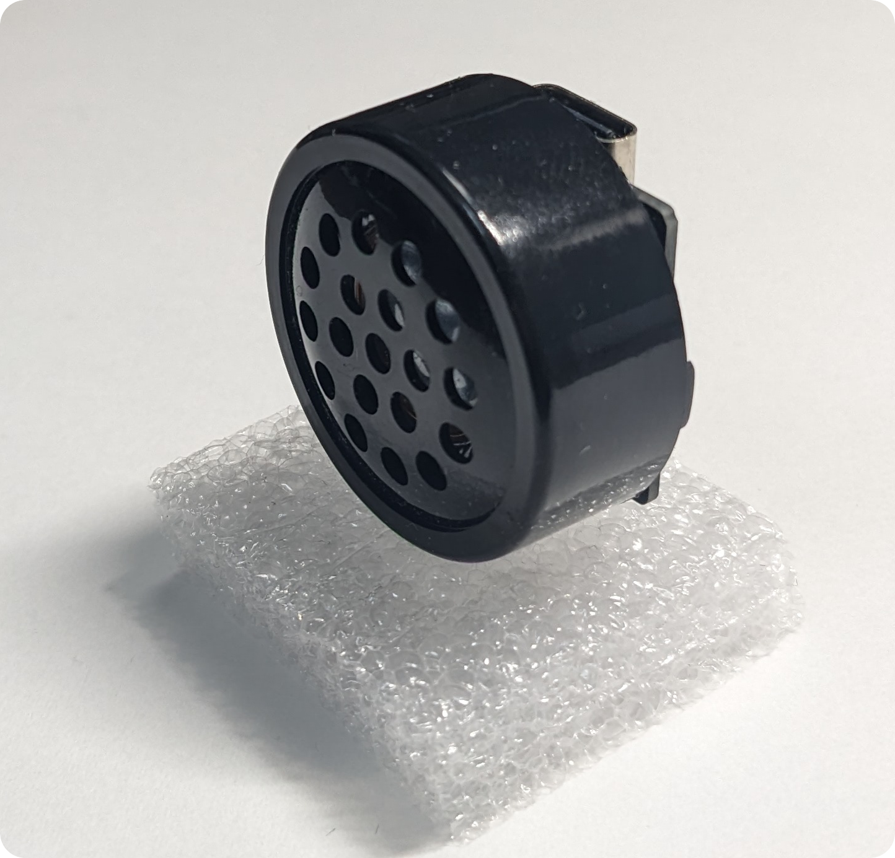
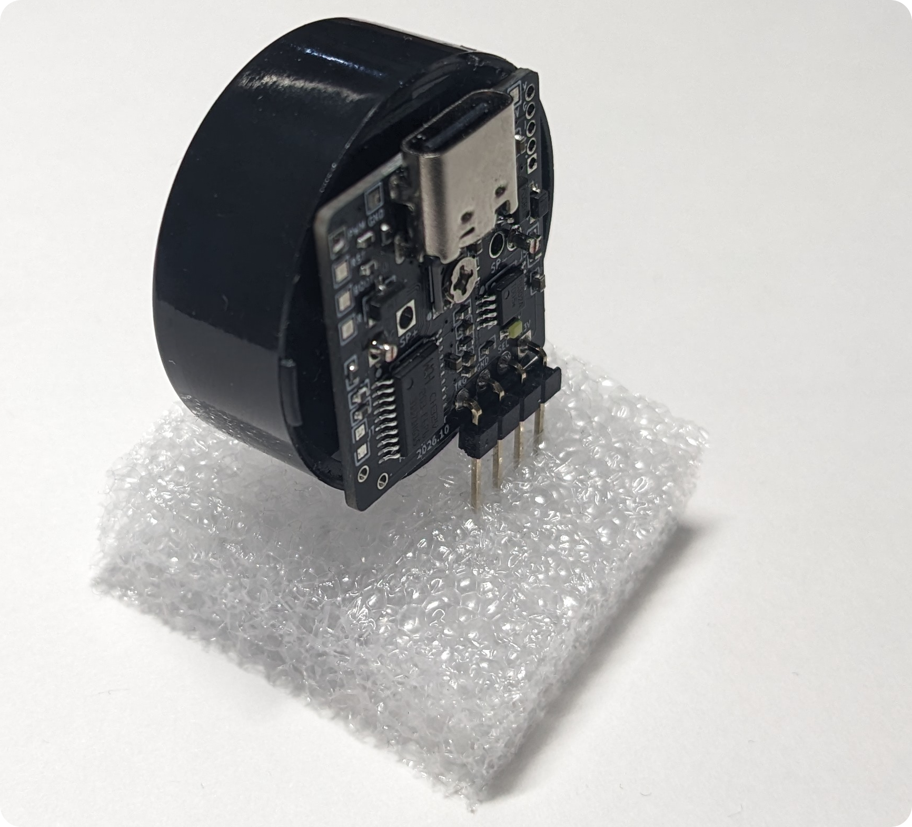
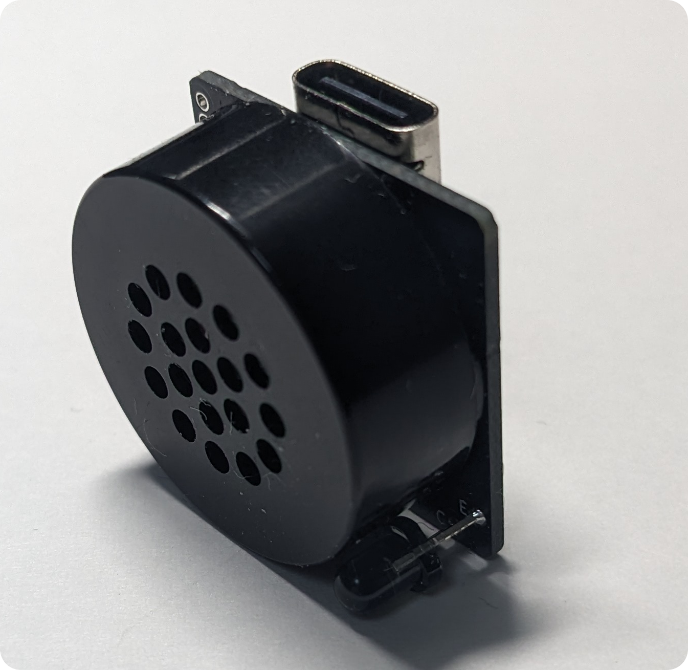
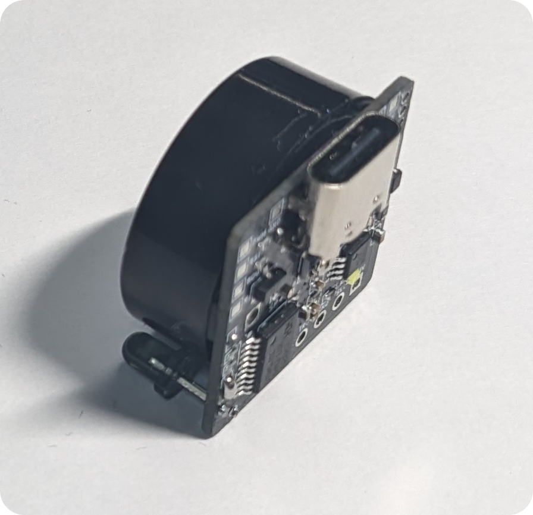
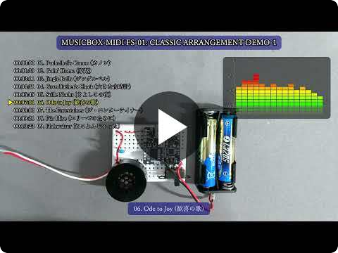
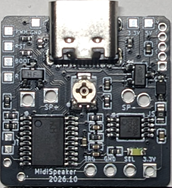

# オーディオアンプ内蔵 9曲入りメロディモジュール [MUSICBOX-MIDI FS-01]

[作品一覧へ戻る](../README.md)


| ダイナミックスピーカーを駆動して、楽器9音色とドラム5音色で音楽を演奏するメロディモジュールです。PC からは USB フラッシュメモリとして認識され、そこに書き込んだ標準MIDIファイルを順に演奏します。設定ファイルで、曲・MIDIチャンネルごとに音量、音色、演奏速度を変更できます。ケース入りの円形小型スピーカーの背面に直接取り付けられます。 |
|:---|

 
 

## 動作動画

<!-- [](https://www.youtube.com/watch?v=f5hhHijweYc) -->

[](https://www.youtube.com/watch?v=f5hhHijweYc)

- 各種動画
  - https://www.youtube.com/watch?v=f5hhHijweYc : クラシック曲アレンジ(上記の動画)
  - https://www.youtube.com/watch?v=M8qboCkSDZQ : JPOP
  - https://www.youtube.com/watch?v=lWfWd9daLQ0 : Ys MIDI Collection(Original ver)
<!--
- https://www.youtube.com/watch?v=34mrgT3ZyQI : Ys MIDI Collection(24ch. Polyphonic ver)
- https://www.youtube.com/watch?v=2OQQydvg6u0 : Ys MIDI Collection(SC88 ver)
-->

## マニュアル

- [FS-01 マニュアル (PDF)](docs/FS-01_manual.pdf)

## 仕様

| 項目 | 値 |
|---|---|
| 電源電圧 | 2.4～3.6 V、または 5 V(USB 給電可) |
| フラッシュメモリ | 約 150 kB(MIDI 圧縮再生可) |
| 音色 | 楽器 9 音色 + ドラム 5 音色 |
| 出力 | ダイナミックスピーカー直結(4～32 Ω) |
| サイズ・質量 | 22 × 22 × 3.5 mm、1.7 g |


## 初期状態で書き込まれているファイル
- クラシック曲 9曲と MIDI.TXT 

## MIDI ファイル圧縮/アレンジ Web アプリ
- 自分で書き込む場合は
- Edge/Chrome では直接書き込み

## 端子



| 端子 | 方向 | 説明 |
|---|---|---|
| ①, ⑨ | 電源 | GND |
| ②, ⑪ | 電源 | 3V(※) |
| ③ | 電源 | 5V(※) |
| ④ | 出力 | PWM |
| ⑤ | 入力 | RESET |
| ⑥ | 入力 | BOOT |
| ⑦ | 入力 | RECOVER |
| ⑧ | 入力 | トリガ |
| ⑩ | 入力 | モード / 進む・戻る |

※ 3V または 5V を給電します。5V は USB から給電してもかまいません。5V を給電すると LDO で降圧され、3V 端子に出力されます。

SP+ と SP- の間にダイナミックスピーカーを接続し、電源端子または USB 端子から給電すると、MIDI ファイルを演奏します。

## 動作モード

起動時のトリガ端子(⑧)とモード端子(⑩)の状態で動作モードが決まります。⑩ は起動後、「次の曲に進む / 前の曲に戻る」を指示する端子になります。

| 起動時のモード端子(⑩) | 起動時のトリガ端子(⑧) | 動作モード |
|---|---|---|
| オープン | オープン | (1) 連続演奏モード |
| オープン | H または L | (2) トリガモード |
| H または L | - | (3) ワンショットモード |

| モード | 動作 |
|---|---|
| (1) 連続演奏 | 常に演奏を続ける。演奏中に ⑩ に H を入力すると次の曲、L で前の曲 |
| (2) トリガ | ⑧ が L の間は演奏し、H になると停止する。⑩ による曲送りも可能 |
| (3) ワンショット | ⑧ が L になるたびに、1曲を最後まで演奏して停止する |

## 設定ファイル MIDI.TXT

USB フラッシュメモリに `MIDI.TXT` を置くと、演奏方法をカスタマイズできます。指定に間違いがある行は無視されます。

```
# MIDI.TXT Example
SONG(1).FILE=MYSONG1.MID   # 1曲目のファイル名
SONG(1).SPEED=120          # 速度120%
SONG(1).CH(1).VOL=3        # CH1の音量を +3dB
SONG(1).CH(2).INST=FLUTE   # CH2 の音色をフルートに
SONG(2).FILE= MYSONG2.MID  # 2曲目のファイル名
SONG(2).ALL.VOL=-6         # 全CHの音量を -6dB
SONG(2).START=20           # 20秒目から開始
SONG(2).LEN=60             # 開始から60秒間演奏
```

指定できる音色: `TUNINGFORK` `XYLOTONE` `SAW` `CLARINET` `SQUARE` `PIANO` `VIOLIN` `FLUTE` `ORGAN` `MUTE`(無音)

> [!WARNING]
> ピエゾスピーカーではほとんど音が出ません。4～32 Ω のダイナミックスピーカーを使用してください。

> [!NOTE]
> MIDI.TXT 内で指定できるファイル名は 8+3 形式のみです。ロングファイルネームは指定できません。

## 詳細解説

(ここにマニュアルに書かれていない解説を追加します。例: 音源方式、MIDI 圧縮の仕組み、スピーカーの選び方、使用例など)

<details>
<summary>更新履歴</summary>

| 日付 | 内容 |
|---|---|
| 2026/10/29 | マニュアル初版 |
| 2026/11/04 | 紹介ページ公開 |

</details>
