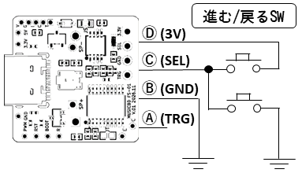
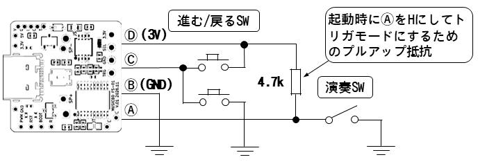
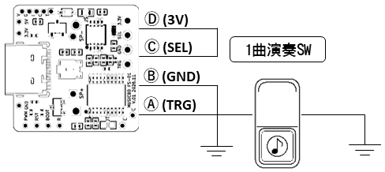
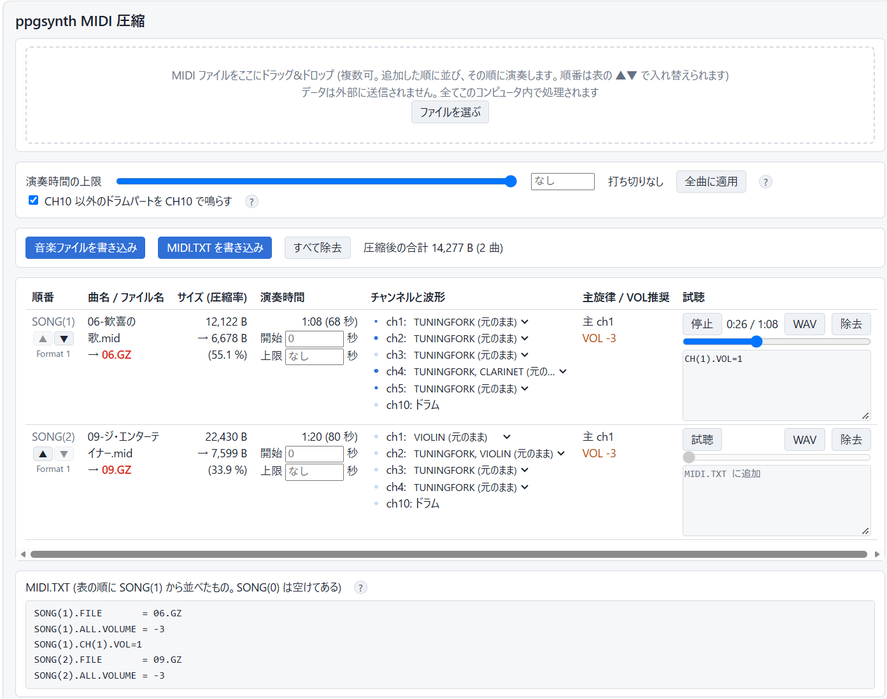
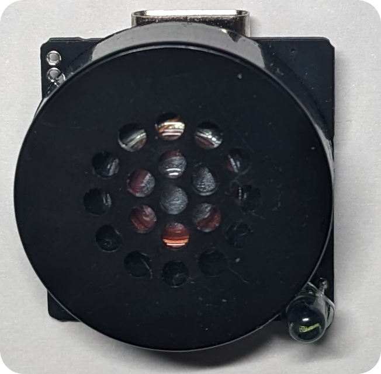

# オーディオアンプ内蔵 9曲入りメロディモジュール [MUSICBOX-MIDI FS-01]

<!-- [モジュール一覧へ](../README.md) -->


| ダイナミックスピーカーを駆動して、楽器9音色とドラム5音色で音楽を演奏するメロディモジュールです。PC に接続すると USB フラッシュメモリとして認識され、書き込んだ標準 MIDI ファイルを順に演奏できます。また設定ファイルを書き込むと、曲・MIDIチャンネルごとに音量、音色、演奏速度などをアレンジできます。Web アプリ上で、MIDI ファイルがどのように演奏されるかをシミュレーションして試聴できます。市販の円形の小型スピーカーの背面に直接取り付けられます。 |
|:---|

<!--
- [演奏] [進む] [戻る] スイッチを追加して演奏をコントロールできます
- MIDI ファイルが本機でどのように演奏されるか、ブラウザ上のエミュレータで確認できます
-->

## ■ 演奏動画
[](https://www.youtube.com/watch?v=f5hhHijweYc)

初期状態でフラッシュメモリに書き込まれているクラシックのアレンジ曲 9 曲です

### ● その他の演奏例
- [&#x23e9; JPOP](https://www.youtube.com/watch?v=M8qboCkSDZQ)
- [&#x23e9; Ys MIDI Collection (Original)](https://www.youtube.com/watch?v=lWfWd9daLQ0)
- [&#x23e9; Ys MIDI Collection (SC88)](https://www.youtube.com/watch?v=2OQQydvg6u0)

## ■ 仕様

| 項目 | 値 |
|---|---|
| 電源電圧 | 2.4～3.6 V、または 5 V (USB 給電可) |
| MIDI ファイル保存用フラッシュメモリ | 約 150 kB |
| サイズ・質量 | 22 × 22 × 3.5 mm、1.7 g |

## ■ 使い方
SP+ と SP- 端子にダイナミックスピーカーを接続し、VDD 端子から 2.4～3.6V を給電すると、フラッシュメモリに書き込まれている MIDI ファイルがファイル名の順に演奏されます。

-  MIDI ファイルは USB フラッシュメモリのルートディレクトリに置きます。演奏できるファイルは Format0 または Format1 の 標準 MIDI 形式です。拡張子は .MID (未圧縮) または .GZ (Web アプリで圧縮済) です。
- MIDI ファイルの音量が大きい場合は、音割れを防ぐために音量を設定してください。下記の Web アプリで書き込んだ場合は自動で最適な音量が設定されます。手動で書き込んだ場合は、設定ファイル (MIDI.TXT) で音量を指定してください。

> [!WARNING]
>  ピエゾスピーカーではほとんど音が聞こえません。4～32 Ω のダイナミックスピーカーを接続してください。

## ■ ダウンロード
- 簡易マニュアル (PDF)
  - [FS-01_manual.pdf](docs/FS-01_manual.pdf)
- 初期 MIDI ファイル(9曲)と設定ファイル
  - [MIDIV1.ZIP](docs/MIDIV1.ZIP)

## ■ 名称と機能


### ● 基本機能とピン
&#x24B6; 〜 &#x24B9; の4ピンで動作を制御できるようになっています。

| 記号 | 回路図上のラベル | 機能 |
|---|---|---|
| &#x24B6; | TRIGGER (PA3) | トリガ |     <!-- A -->
| &#x24B7; | GND | GND |                  <!-- B -->
| &#x24B8; | FILESEL (PA7) | モード選択 | <!-- C -->
| &#x24B9; | 3_3V | VDD (2.4～3.6V) |     <!-- D -->
| &#x24BA; | SP1 | SP+ (スピーカー出力+) |     <!-- E -->
| &#x24BB; | SP1 | SP- (スピーカー出力-) |     <!-- F -->
| &#x24BC; | R1 | 音量調節つまみ |        <!-- G -->
| &#x24BD; | R14, LED2 | フォトトランジスタ接続用端子 | <!-- H -->
| &#x24BE; | LED1 | USB アクセス LED |    <!-- I -->

> [!NOTE]
> 起動時のトリガ端子(&#x24B6;) とモードセレクト端子(&#x24B8;) の状態によって、下記の「動作モード」の動作を行います。&#x24B6; と &#x24B8; に何も接続しなければ連続演奏モードになり、常に演奏を続けます。

### ● その他の機能とピン
| 記号 | 回路図上のラベル | 機能 |
|---|---|---|
| ① | PWM (PA0)| PWM 音声出力 |
| ② | RESET | NRST |
| ③ | BOOT0 | BOOT0 |
| ④ | RECOVER (PA6) | リカバリモード用入力 |
| ⑤ | GND | GND |
| ⑥ | 3_3V | VDD (2.4～3.6V) |
| ⑦ | 5V | 電源 (5V) |
| ⑧ | 5V | 電源 (5V) |
| ⑨ | GND | GND |
| ⑩ | SWDIO | SWDIO |
| ⑪ | SWDCL | SWDCL |
| ⑫ | TX (PA2)| TX |

> [!NOTE]
> VDD の代わりに USB または ⑦,⑧ の電源 (5V) 端子から給電することもできます。その場合は内蔵のレギュレータで降圧され、VDD 端子に 3.3V が出力されます。

## ■ 回路図
[](images/schematic1.pdf)

## ■ 動作モード
起動時のトリガ端子(&#x24B6;) とモードセレクト端子(&#x24B8;) の状態によって「連続演奏モード」「オルゴールモード」「チャイムモード」のいずれかの動作を行います。

| 起動時のモードセレクト端子(&#x24B8;) | 起動時のトリガ端子(&#x24B6;) | 動作モード |
|---|---|---|
| オープン | オープン | (1) 連続演奏モード |
| オープン | H または L | (2) オルゴールモード |
| H または L | - | (3) チャイムモード |

### (1) 連続演奏モード



起動時にモードセレクト端子(&#x24B8;) とトリガ端子(&#x24B6;) が両方オープンの場合は、連続演奏モードになります。このモードでは常に演奏を続けます。

※ 演奏中は、モードセレクト端子(&#x24B8;)を使って曲の選択ができます。モードセレクト端子(&#x24B8;)に H を入力すると次の曲に進み、L を入力すると前の曲に戻ります。最初の曲で前の曲に戻る操作をしても無視されます。

> [!WARNING]
> モードセレクト端子(&#x24B8;)を H または L にしたまま電源を入れるとチャイムモードで起動します。スイッチやジャンパピンで曲を選択する場合は、オープンの状態で電源を入れてください。

### (2) オルゴールモード



起動時に、モードセレクト端子(&#x24B8;)がオープンで、かつトリガ端子(&#x24B6;)が H または L の場合はオルゴールモードになります。このモードでは、トリガ端子(&#x24B6;)が L の間は演奏し、H になると停止します。

※ 演奏中は、モードセレクト端子(&#x24B8;)を使って曲の選択ができます。モードセレクト端子(&#x24B8;)に H を入力すると次の曲に進み、L を入力すると前の曲に戻ります。最初の曲で前の曲に戻る操作をしても無視されます。ただし演奏停止中はスリープモードのため、モード端子(&#x24B8;)への入力は無効です。

### (3) チャイムモード



モードセレクト端子(&#x24B8;) が H または L の状態で起動すると、トリガ端子(&#x24B6;)が L になるたびに、1 曲を最後まで演奏し停止します。再度トリガ端子が L になると、次の曲が演奏されます。演奏中にトリガ端子が L になっても無視されます。トリガ端子(&#x24B6;)に何も接続しないと演奏しません。

## ■ 設定ファイルの例

USB フラッシュメモリのルートディレクトリに `MIDI.TXT` を置くと、曲・MIDIチャンネルごとに音量、音色、演奏速度などをアレンジできます。指定に間違いがある行は単に無視されます。詳細な文法は[詳細資料 (DETAILS.md)](DETAILS.md) の「MIDI.TXT の文法」の節を参照してください。

```
# MIDI.TXT Example
SONG(1).FILE=MYSONG1.MID   # 1曲目のファイル名
SONG(1).SPEED=120          # 速度120%
SONG(1).CH(1).VOL=3        # CH1 の音量を +3dB
SONG(1).CH(2).INST=FLUTE   # CH2 の音色をフルートに
SONG(2).FILE=MYSONG2.GZ    # 2曲目のファイル名
SONG(2).ALL.VOL=-6         # 全 CH の音量を -6dB
SONG(2).START=20           # 20秒目から開始
SONG(2).LEN=60             # 開始から60秒間演奏
```

> [!WARNING]
> MIDI.TXT 内で指定できるファイル名は 8+3 形式のみです。ロングファイルネームは指定できません。MIDI.TXT で MIDI ファイル名を指定した場合は、指定したファイルのみが演奏されて、それ以外は存在しても演奏されません。

## ■ MIDI ファイル圧縮書き込み用 Web アプリ


- [Web アプリを開く](https://hoshimilkali.github.io/kits/tools/ppgsynth_gzweb.html)
### ● 機能
- Edge/Chrome 用の Web アプリです。
- MIDI ファイルが本機でどのように再生されるかを試聴できます。ブラウザ上で音色や演奏時間、演奏速度をアレンジできます。
- 試聴・アレンジ後に MIDI ファイルを圧縮して、本モジュールに直接書き込めます。設定ファイル MIDI.TXT も同時に書き込めます。モジュールを USB 接続して「音楽ファイルを書き込み」「MIDI.TXT を書き込み」ボタンを押し、書き込み先のドライブを指定してください。
- 単一の HTML ファイルです。ブラウザ内で動作し、ファイルは外部に送信されません。

## ■ スピーカー
- 本機は下記のダイナミックスピーカーの背面に直接取り付けられる構造になっています。

| スピーカー | 取付時表面 | 取付時裏面 | URL |
|---|---|---|---|
| [UGSM30A-8-01 (秋月)](https://akizukidenshi.com/catalog/g/g109270/)<br>[UGSM30B-8-01 (秋月)](https://akizukidenshi.com/catalog/g/g109271/) |  |  | 0.15W, 直径29mm, 厚さ12.7mm, ピン間隔15mm<br>0.15W, 直径29.2mm, 厚さ11.8mm, ピン間隔15mm|
| [UGSM23A (秋月)](https://akizukidenshi.com/catalog/g/g109797/ )|  |  | 0.08W, 直径22.5mm, 厚さ8.5mm, ピン間隔10mm |

## ■ フォトトランジスタによる演奏の ON/OFF


- 画像のように、基板上にフォトトランジスタ (LED2, NJL7502L) を追加すると、明るいところで演奏を開始するオルゴールとして動作します。
- スピーカーに [UGSM23A (秋月)](https://akizukidenshi.com/catalog/g/g109797/) を使用し、基板上の JT のシルクのランドをショートしてください。 動作モードはオルゴールモードになります。モードセレクト端子(&#x24B8;)による曲の選択も可能です。

## ■ 詳細資料

設定ファイル `MIDI.TXT` の文法、動作モードの詳細、USB 接続時の動作、出荷時の状態に戻す方法、アンプとオーディオ回路、MIDI ファイルのデコード、発音の方式、ファイルシステムについては、[詳細資料 (DETAILS.md)](DETAILS.md) を参照してください。

<details>
<summary>更新履歴</summary>

| 日付 | 内容 |
|---|---|
| 2026/10/29 | マニュアル初版 |
| 2026/11/04 | 紹介ページ公開 |
| 2026/11/10 | 詳細資料を別ページ (DETAILS.md) に分割 |

</details>
