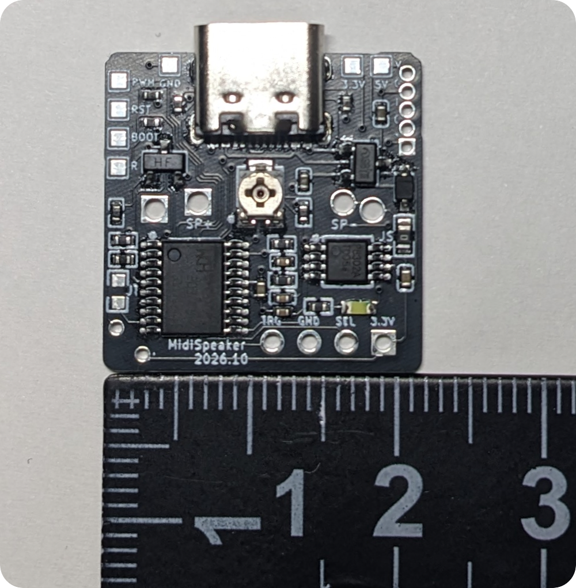
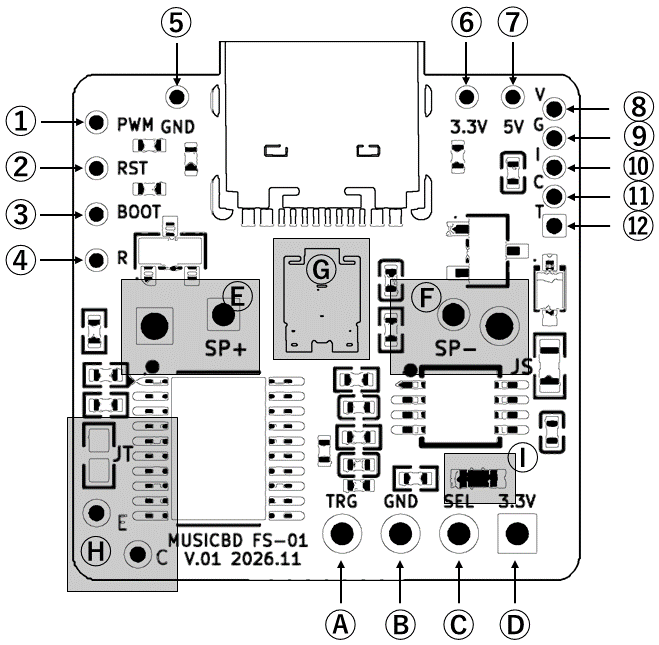
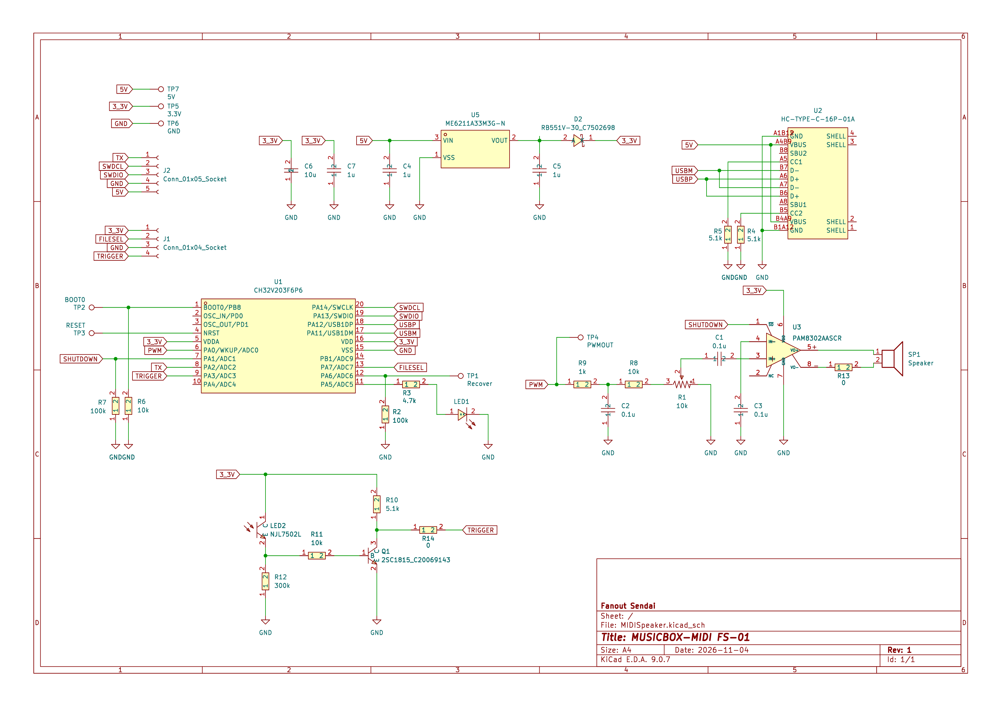

# オーディオアンプ内蔵 9曲入りメロディモジュール [MUSICBOX-MIDI FS-01]

<!-- [モジュール一覧へ](../README.md) -->

  

| ダイナミックスピーカーを駆動して、楽器9音色とドラム5音色で音楽を演奏するメロディモジュールです。PC に接続すると USB フラッシュメモリとして認識され、そこに書き込んだ標準 MIDI ファイルを順に演奏できます。設定ファイルを書き込むと、曲・MIDIチャンネルごとに音量、音色、演奏速度などをアレンジできます。Web アプリ上で、MIDI ファイルがどのように演奏されるかをシミュレーションして試聴できます。市販の円形の小型スピーカーの背面に直接取り付けられます。 |
|:---|

## 演奏動画
[](https://www.youtube.com/watch?v=f5hhHijweYc)

初期状態でフラッシュメモリに書き込まれているクラシックのアレンジ曲 9 曲です

### その他の演奏動画
- [&#x23e9; JPOP](https://www.youtube.com/watch?v=M8qboCkSDZQ)
- [&#x23e9; Ys MIDI Collection (Original)](https://www.youtube.com/watch?v=lWfWd9daLQ0)
- [&#x23e9; Ys MIDI Collection (SC88)](https://www.youtube.com/watch?v=2OQQydvg6u0)

## 仕様

| 項目 | 値 |
|---|---|
| 電源電圧 | 2.4～3.6 V、または 5 V (USB 給電可) |
| フラッシュメモリ | 約 150 kB (MIDI 圧縮再生可) |
| 音色 | 楽器 9 音色 + ドラム 5 音色 |
| 出力 | ダイナミックスピーカー |
| サイズ・質量 | 22 × 22 × 3.5 mm、1.7 g |

## 簡易マニュアル
- [&#x1f4c4; FS-01 簡易マニュアル (PDF)](docs/FS-01_manual.pdf)

## 使い方
SP+ と SP- 端子にダイナミックスピーカーを接続し、VDD 端子に 2.4～3.6V を給電すると、書き込んだ MIDI ファイルが演奏されます。

> [!WARNING]
> ピエゾスピーカーではほとんど音が出ません。4～32 Ω のダイナミックスピーカーを使用してください。

<!--
- [演奏] [進む] [戻る] スイッチを追加して演奏をコントロールできます
- MIDI ファイルが本機でどのように演奏されるか、ブラウザ上のエミュレータで確認できます
-->

## 各部の名称と機能


### 基本機能

| 記号 | 回路図上のラベル | 機能 |
|---|---|---|
| &#x24B6; | TRIGGER | トリガ (PA3) |   <!-- A -->
| &#x24B7; | GND | GND |                <!-- B -->
| &#x24B8; | FILESEL | モード選択 (PA7) |    <!-- C -->
| &#x24B9; | 3_3V | VDD (2.4～3.6V) |   <!-- D -->
| &#x24BA; | - | スピーカ出力 (SP+) |   <!-- E -->
| &#x24BB; | - | スピーカ出力 (SP-) |   <!-- F -->
| &#x24BC; | R1 | 音量調節つまみ |      <!-- G -->
| &#x24BD; | R14,LED2 | フォトトランジスタ接続用端子 | <!-- H -->
| &#x24BE; | LED1 | USB アクセス LED |  <!-- I -->
- 起動時の &#x24B6;のトリガ端子(PA3) と &#x24B8;のモード選択端子(PA7) の状態によっては、下記の「オルゴールモード」「チャイムモード」の動作を行います

### その他のピンアサイン
| 記号 | 回路図上のラベル | 機能 |
|---|---|---|
| ① | PWM | PWM 音声出力 (PA0) |
| ② | RESET | NRST |
| ③ | BOOT0 | BOOT0 |
| ④ | RECOVER | リカバリモード用入力 (PA6) |
| ⑤ | GND | GND |
| ⑥ | 3_3V | VDD (2.4～3.6V) |
| ⑦ | 5V | 電源 (5V) |
| ⑧ | 5V | 電源 (5V) |
| ⑨ | GND | GND |
| ⑩ | SWDIO | SWDIO |
| ⑪ | SWDCL | SWDCL |
| ⑫ | TX | TX (PA2) |

- VDD の代わりに USB または ⑦,⑧ の電源 (5V) 端子から給電することもできます。その場合は内蔵のレギュレータで降圧され、VDD 端子に 3.3V が出力されます。
- ① は外部アンプへの出力用です
<!-- - ⑧～⑫ はデバッグ用端子です -->

## 動作モード

### 連続演奏モード
### トリガモード
### ワンショットモード

起動時のトリガ端子(⑧)とモード端子(⑩)の状態で動作モードが決まります。⑩ は起動後、「次の曲に進む / 前の曲に戻る」を指示する端子になります。

| 起動時のモード端子(⑩) | 起動時のトリガ端子(⑧) | 動作モード |
|---|---|---|
| オープン | オープン | (1) 連続演奏モード |
| オープン | H または L | (2) トリガモード |
| H または L | - | (3) ワンショットモード |

| モード | 動作 |
|---|---|
| (1) 連続演奏 | 常に演奏を続ける。演奏中に ⑩ に H を入力すると次の曲、L で前の曲 |
| (2) トリガ | ⑧ が L の間は演奏し、H になると停止する。⑩ による曲送りも可能 |
| (3) ワンショット | ⑧ が L になるたびに、1曲を最後まで演奏して停止する |

## 設定ファイル

USB フラッシュメモリのルートディレクトリに `MIDI.TXT` を置くと、演奏方法をカスタマイズできます。指定に間違いがある行は単に無視されます。

```
# MIDI.TXT Example
SONG(1).FILE=MYSONG1.MID   # 1曲目のファイル名
SONG(1).SPEED=120          # 速度120%
SONG(1).CH(1).VOL=3        # CH1の音量を +3dB
SONG(1).CH(2).INST=FLUTE   # CH2 の音色をフルートに
SONG(2).FILE= MYSONG2.MID  # 2曲目のファイル名
SONG(2).ALL.VOL=-6         # 全CHの音量を -6dB
SONG(2).START=20           # 20秒目から開始
SONG(2).LEN=60             # 開始から60秒間演奏
```

指定できる音色: `TUNINGFORK` `XYLOTONE` `SAW` `CLARINET` `SQUARE` `PIANO` `VIOLIN` `FLUTE` `ORGAN` `MUTE`(無音)


> [!NOTE]
> MIDI.TXT 内で指定できるファイル名は 8+3 形式のみです。ロングファイルネームは指定できません。

## 初期状態で書き込まれているファイル
- クラシック曲 9曲と MIDI.TXT ...

## MIDI ファイル圧縮 & 演奏アレンジ用 Web アプリ
- [ppgsynth MIDI 圧縮 Web アプリを開く](https://hoshimilkali.github.io/kits/tools/ppgsynth_gzweb.html)
- ブラウザ内だけで動作し、ファイルは送信されません
- 単一のファイル
- 自分で書き込む場合は...
- Edge/Chrome では直接書き込み...

## 回路図
[](images/schematic1.pdf)

## MIDI.TXT の文法
## MIDI ファイルの形式と圧縮
## スピーカー
 


## フォトトランジスタの追加
## リカバリモード
## 音色とパラメータ

<details>
<summary>更新履歴</summary>

| 日付 | 内容 |
|---|---|
| 2026/10/29 | マニュアル初版 |
| 2026/11/04 | 紹介ページ公開 |

</details>
